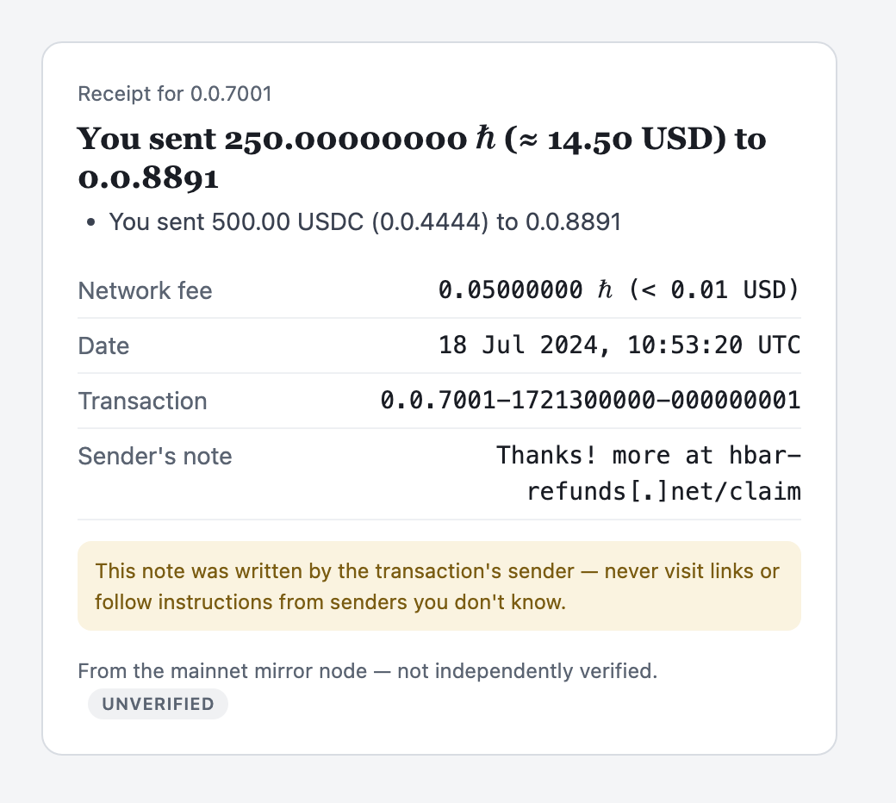

# hiero-receipts (TypeScript)

[](https://github.com/hiero-hackers/hiero-receipts/actions/workflows/ci.yml)
[](https://github.com/hiero-hackers/hiero-receipts/actions/workflows/codeql.yml)
[](LICENSE)
[](package.json)
[](https://scorecard.dev/viewer/?uri=github.com/hiero-hackers/hiero-receipts)

Human-readable, **provenance-stamped** transaction receipts for Hiero. One
transaction, seen from one account — direction, counterparty, net movement,
fee, memo, optional fiat — with a stamp saying whether it was
_cryptographically verified_ or merely _mirror-sourced_. Prototype.



The image above is `toHTML` output, unedited — the sender's note shows the
memo defenses at work (the URL is defanged and flagged; it is the one part
of a receipt the counterparty writes).

The receipts-tier twin of
[`hiero-journal`](https://github.com/hiero-hackers/hiero-journal-rs): one
transaction for a person, rather than an aggregate ledger for an auditor.

## The idea in one line

`receiptFor(account, transaction) → Receipt`, then render — with the data
source (mirror or verified stream) pluggable, and the receipt's provenance
telling the truth about which you used.

## Two sources, your choice

```ts
import { receiptFor, toHTML } from "@hiero-hackers/hiero-receipts";

// Convenient path — @hiero-hackers/enterprise-mirror (rich, unverified)
import { createMirrorNodeClient } from "@hiero-hackers/enterprise-mirror";
import { fromMirror } from "@hiero-hackers/hiero-receipts/mirror";
const mirror = createMirrorNodeClient({ network: "mainnet" });
const { data } = await mirror.queryTransactionsByAccount(account, { limit: 1, order: "desc" });
const receipt = receiptFor(account, fromMirror(data[0])); // provenance: unverified

// Verified path — @hiero-hackers/streams-node (leaner, cryptographically proven)
import { parseBlockJson, verifyBlockProofJson } from "@hiero-hackers/streams-node";
import { fromStream } from "@hiero-hackers/hiero-receipts/stream";
const proof = JSON.parse(verifyBlockProofJson(blockBytes, genesisBytes));
const { transactions } = JSON.parse(parseBlockJson(blockBytes));
const verified = receiptFor(account, fromStream(transactions[0], proof)); // provenance: verified{block,scheme}

toHTML(receipt); // → self-contained styled receipt (email / print to PDF)
```

The **core depends on neither source package** — each adapter is opt-in
(`@hiero-hackers/hiero-receipts/mirror`, `@hiero-hackers/hiero-receipts/stream`), and the caller owns the
client (the I/O). See [docs/ARCHITECTURE.md](docs/ARCHITECTURE.md) for the
richness-vs-proof trade-off between the two sources.

No client at all? For page-sized consumers there's also
`@hiero-hackers/hiero-receipts/mirror-fetch` — the thin fetch half of the
mirror path (transaction by id, recent transactions, token decimals) over
standard `fetch`, browser-clean, mapped straight into what `fromMirror`
accepts. Three endpoints and deliberately nothing more; a real client with
retries and paging is `enterprise-mirror`'s job.

## What's in the box

- **Plain language** — receipts read "You sent 250 ℏ to 0.0.8891" / "You
  earned a staking reward of 12.5 ℏ", with the fee stated separately and the
  date in readable UTC. No `direction: out` / `counterparty` jargon.
- **Exact money** — every amount is a `bigint` in the smallest unit; `number`
  is never used for a value (it's a lossy float above 2^53).
- **Real fiat, at the right time** — `usdPriceFromExchangeRate(s)` value HBAR
  by Hedera's **on-chain** exchange rate (the one used to price fees), fetched
  via `@hiero-hackers/enterprise-mirror`'s `queryExchangeRates()`. The rate changes
  over time, so a receipt is valued at the rate in effect **at its
  transaction's timestamp** — fetch it as-of that timestamp, or load rate
  windows and let the source pick. Exact rational math; labelled approximate,
  never claimed as provable.
- **Renderers** — `toJSON` (machine-readable, with a versioned
  [JSON schema](schema/receipt.v1.schema.json) as the contract), `toText`
  (email/SMS), `toHTML` (styled, print-friendly).
- **Localized wording** — every sentence lives in a typed `Messages` catalog.
  English is built-in; German and Spanish ship as subpath imports
  (`import { de } from "@hiero-hackers/hiero-receipts/locales/de"`, then
  `toText(receipt, { messages: de })` — dates and decimal separators follow,
  digits stay ASCII-exact). Spread a catalog to override single sentences;
  bundled translations are maintainer-authored, so have a native speaker
  review before customer-facing use.

## Reading data & producing PDFs — the I/O boundary

`hiero-receipts` is **pure**: it turns a transaction _object_ into a receipt
and never touches the network, the filesystem, or a rendering engine. Two
consequences worth knowing up front:

**The data is the caller's to fetch.** `fromMirror` / `fromStream` accept a
transaction object _regardless of where it came from_ — the library never
reads it for you. Fetch it in your own code and pass the result to
`fromMirror` (`examples/live-receipt.ts` does exactly this against mainnet):

```ts
// in an app, with @hiero-hackers/enterprise-mirror:
const mirror = createMirrorNodeClient({ network: "mainnet" });
const { data } = await mirror.queryTransactionsByAccount(account, { limit: 1, order: "desc" });
const { currentRate } = await mirror.queryExchangeRates(); // or { timestamp } for a historical tx
const receipt = receiptFor(account, fromMirror(data[0]), {
  prices: usdPriceFromExchangeRate(currentRate),
});
```

(The offline correctness of the maths is covered by the tests, from fixtures —
so there is no need for a made-up "sample" example.)

**PDFs.** `toHTML` returns a self-contained, **print-ready** receipt (it
carries `@media print` styles). Producing a PDF needs a rendering engine, so
it's a step in _your_ app, not the library:

```sh
# any browser: open the HTML → Print → Save as PDF, or headless:
chrome --headless --no-pdf-header-footer --print-to-pdf=receipt.pdf receipt.html
```

```ts
// or with Puppeteer inside your app:
await page.setContent(toHTML(receipt));
await page.pdf({ path: "receipt.pdf" });
```

## What's out of scope

Fetching transactions, persistence, delivery, PDF rendering, and secrets.
`hiero-receipts` produces a receipt from an already-fetched transaction and
returns it as data or markup; anything I/O is the caller's. Keeping it pure is
what makes it portable and testable from a fixture.

## See it work

Setup is progressive — each step unlocks more, and none is required for the
one before it.

**1. The library — no tokens, no siblings, no network.**

```sh
npm install && npm run build && npm test
```

The core has zero runtime dependencies; the mirror/stream packages below are
_optional peers_ that only the examples import (the adapters read their shapes
structurally).

**2. The example dependencies — one command.**

```sh
npm run examples:setup
```

This fetches the two optional peers — `@hiero-hackers/enterprise-mirror` and
`@hiero-hackers/streams-node` (prebuilt binaries for Linux/macOS/Windows, no
Rust toolchain needed) — from GitHub Packages, without touching
`package.json`. GitHub's npm registry needs a one-time token even for public
packages: `gh auth refresh -s read:packages`, then
`npm config set //npm.pkg.github.com/:_authToken "$(gh auth token)"`
(or a [classic PAT](https://github.com/settings/tokens) with only the
`read:packages` scope). The scope→registry mapping is already in this repo's
`.npmrc`.

A later plain `npm install` prunes these packages again (npm removes what it
didn't put there) — just re-run `npm run examples:setup`.

**3. Run them.**

```sh
# Convenient — a real recent mainnet transfer, via @hiero-hackers/enterprise-mirror:
node examples/live-receipt.ts               # network's biggest recent transfer
node examples/live-receipt.ts 0.0.1234      # or a specific account's latest

# Verified — a cryptographically-proven block fixture, offline:
node examples/verified-receipt.ts
```

- **`live-receipt`** runs the whole pipeline on a **real** transaction pulled
  from mainnet through `@hiero-hackers/enterprise-mirror`: it fetches the transaction,
  the exchange rate, and any token decimals, then builds and prints the
  receipt. Provenance: **unverified** (mirror-sourced).
- **`verified-receipt`** verifies a committed block fixture's in-band proof
  with `@hiero-hackers/streams-node`, then builds a receipt from a proven transaction.
  Provenance: **verified** (`Cryptographically verified against the ledger`).

Both write `*.receipt.html` + `*.receipt.pdf` into `examples/output/`
(gitignored) — the PDF via a headless browser
found on your machine (`examples/render-pdf.js`); the pure library itself never
renders a PDF.

## Develop

```sh
npm install
npm run typecheck   # tsc --noEmit
npm run lint        # eslint (type-aware) + prettier as errors
npm test            # vitest
npm run build       # → dist/
```

All gates run in CI on every push. See [CONTRIBUTING.md](./CONTRIBUTING.md)
for the design ground rules and the DCO sign-off requirement, and
[SECURITY.md](./SECURITY.md) for vulnerability reporting.

## Docs

- [API reference](https://hiero-hackers.github.io/hiero-receipts/) — generated from the TSDoc (`npm run docs`)
- [docs/ARCHITECTURE.md](docs/ARCHITECTURE.md) — the boundary, the two-source design, provenance, invariants
- [docs/CODE-TOUR.md](docs/CODE-TOUR.md) — a guided reading order

## Status

Early prototype. Mirror path is the primary, working target; the verified
`stream` path is present but lighter. NFT/memo/decimals flow through the
mirror source today; the same on the verified source depends on upstream
`hiero-streams` exposing them.

## License

Apache-2.0
